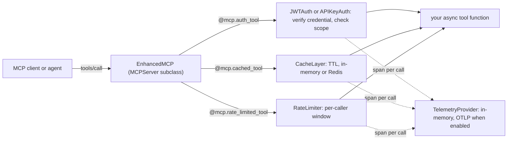

# MCP Server Toolkit: auth, caching and telemetry for Python MCP tools

[](https://github.com/ChunkyTortoise/mcp-server-toolkit/actions/workflows/ci.yml)
[](pyproject.toml)
[](LICENSE)

A Python library of decorators that add token auth with scopes, a read-only SQL allowlist, caching, per-caller rate limits and OpenTelemetry spans to tools on an MCP server built with the official MCP SDK.

## Results

The auth and scope gate is tested against a 45-case adversarial corpus (prompt injection, token forgery, scope escalation, cache poisoning, data exfiltration). Every number below comes from a committed file or a command that needs no API key and no network.

| Metric | Result | n | Dataset | Date | Model | Baseline | Reproduce |
|---|---|---|---|---|---|---|---|
| Corpus cases where the gate's outcome matches `expected_blocked` | **38 of 45 cases**; **7 known gaps** pinned as strict xfail | 45 | [`injection_corpus.jsonl`](tests/adversarial/injection_corpus.jsonl) | 2026-11-17 | none (deterministic gate) | the corpus labels | `uv run pytest tests/gates/test_gate_safety.py -q` |
| Test suite | **1065 passed**, **11 skipped** (Postgres and Redis integration) | **1083** collected | [`tests/`](tests/) | 2026-11-17 | none | n/a | `uv run pytest -q` |
| Line coverage of `mcp_toolkit` | **87.59%** (CI floor **80%**) | 1 run | [`tests/`](tests/) | 2026-11-17 | none | CI floor in [`ci.yml`](.github/workflows/ci.yml) | `uv run pytest -q --cov=mcp_toolkit` |
| Multi-LLM routing checks | **26/26** | 26 | [`evals/`](evals/) | 2026-11-17 | none (providers mocked) | n/a | `uv run python evals/run_evals.py` |
| Deterministic smoke checks (routing, cost, JWT, cache) | **10/10** | 10 | [`evals/quality/`](evals/quality/) | 2026-11-17 | none; the LLM judge has no committed run | n/a | `uv run python evals/quality/runner.py` |
| In-memory cache P50 latency, hit vs miss, on a mock tool | **0.013 ms** hit vs **0.028 ms** miss (**2.1x**) | 500 iterations | [`benchmarks/run-2026-11-17.txt`](benchmarks/run-2026-11-17.txt) | 2026-11-17 | none | cache miss | `uv run python benchmarks/bench_cache.py` |

Python 3.13.11, macOS arm64 (Apple M4). The cache row measures decorator overhead around a tool that only awaits `asyncio.sleep(0)`, not tool work; repeat runs printed 2.0x to 2.2x. Each number is registered in [`docs/claims.yaml`](docs/claims.yaml), and `python scripts/check_claims.py --check` fails CI when a README number has no entry. Scope and gaps: [Decisions, failures, limits](#decisions-failures-limits).

## Quickstart

Needs [uv](https://docs.astral.sh/uv/) and Python 3.10+. No API key, no network after install.

```bash
git clone https://github.com/ChunkyTortoise/mcp-server-toolkit.git && cd mcp-server-toolkit
uv sync --frozen --extra dev
uv run pytest -q
uv run python examples/verified_cache.py
```

The test run should end with `1065 passed, 11 skipped, 7 xfailed`. The cache demo dispatches one tool twice through the MCP SDK in-process and prints two `Hello, World!` results, `tool_executions: 1`, then `cache_hit: false` and `cache_hit: true` from the recorded telemetry ([captured run](docs/assets/cache-run.json), [provenance](docs/VERIFIED_DEMO.md)). With pip instead of uv: `pip install -e ".[dev]"`. The PyPI package is an older 0.1.0 preview that does not include this code, so install from source.
<!-- TODO(Cayman): publish 0.4.x to PyPI and create the v0.4.0 GitHub release (docs/RELEASING.md), then replace this source-install note and add a PyPI version badge. -->

Inspect the example server in the MCP Inspector (needs Node.js):

```bash
npx @modelcontextprotocol/inspector uv run python examples/basic_server.py
```

<details>
<summary>Install only the extras you need</summary>

```bash
pip install -e "."                 # core framework
pip install -e ".[database]"       # + PostgreSQL/pgvector (sqlglot, sqlalchemy, asyncpg)
pip install -e ".[web]"            # + web scraping (beautifulsoup4, lxml)
pip install -e ".[files]"          # + file processing (pypdf, openpyxl)
pip install -e ".[redis]"          # + Redis-backed caching
pip install -e ".[auth]"           # + JWT/OAuth 2.1 (PyJWT[cryptography])
pip install -e ".[telemetry]"      # + OpenTelemetry + OTLP exporter
pip install -e ".[gmail]"          # + Gmail client
pip install -e ".[gcal]"           # + Google Calendar client
pip install -e ".[all]"            # database, web, files, redis, auth, telemetry
pip install -e ".[dev]"            # [all] + tests and lint tooling (gmail and gcal are separate)
```

The example below needs only `".[auth]"`.

</details>

## What a guarded tool looks like

```python
import asyncio, jwt
from mcp.server.mcpserver.exceptions import ToolError
from mcp_toolkit import EnhancedMCP, JWTAuth, MCPTestClient

SECRET = "replace-with-a-32-byte-or-longer-secret"
auth = JWTAuth(secret=SECRET)  # or JWTAuth(jwks_uri=..., audience=..., issuer=...) for RS256
mcp = EnhancedMCP("orders")

@mcp.auth_tool(auth, required_scope="orders:read")
async def get_order(order_id: str, token: str = "") -> str:
    return f"order {order_id}: shipped"

async def main():
    client = MCPTestClient(mcp)  # in-process MCP dispatch, no transport
    token = jwt.encode({"sub": "agent-1", "scope": "orders:read", "exp": 4102444800}, SECRET, algorithm="HS256")
    print(await client.call_tool("get_order", {"order_id": "42", "token": token}))
    try:
        await client.call_tool("get_order", {"order_id": "42", "token": "forged"})
    except ToolError as exc:
        print(exc)

asyncio.run(main())
```

The first call prints `order 42: shipped`. The forged call raises `ToolError`, which the example catches and prints as `Error executing tool get_order: Unauthorized: malformed token`; the tool body never runs. Each auth decision is also written as a JSON audit-log line. To serve the same tool to Claude Desktop or any MCP client, call `mcp.run()` instead of using `MCPTestClient`; `bash examples/claude_desktop_app/setup.sh` wires three of the pre-built servers into Claude Desktop.

<p align="center">
  
</p>

## Hosted HTTP gateway

For a server reachable over HTTP, `mcp-toolkit-gateway` serves the MCP streamable HTTP transport and verifies the bearer token at the transport, so tokens stay out of tool arguments ([ADR-0008](docs/adr/ADR-0008-transport-auth.md), bind and credential rules in [DEPLOYMENT.md](docs/DEPLOYMENT.md)). Local demo with an HS256 secret:

```bash
export MCP_JWT_SECRET=local-demo-secret-change-me-32-bytes-min
uv run mcp-toolkit-gateway & sleep 3                            # listens on 127.0.0.1:8000/mcp
curl -s -o /dev/null -w '%{http_code}\n' -X POST http://127.0.0.1:8000/mcp   # 401: no bearer
uv run mcp-toolkit-gateway --print-demo-token orders:read       # five-minute token for an MCP client
```

With that token in an `Authorization: Bearer` header, an MCP `initialize` request returns 200 (checked locally on 2026-11-17).

CI installs the built wheel, boots the gateway and asserts the 401 on every run ([`ci.yml`](.github/workflows/ci.yml)). Production use takes `MCP_JWKS_URI`, `MCP_ISSUER` and `MCP_RESOURCE_URL` from your identity provider; the demo secret path is for local testing only.

## How it works



Each decorator registers the function as an MCP tool and runs its check before your code. The example at the top of this page uses `auth_tool`.

- **Auth:** `JWTAuth` verifies HS256 tokens with a shared secret, or RS256 tokens against a JWKS endpoint with key caching and rotation through PyJWT, and checks `aud` and `iss` when configured. `requires_scope` and `auth_tool` refuse the call before the tool body runs. `APIKeyAuth` stores SHA-256 hashes of keys. Code: [`auth.py`](mcp_toolkit/framework/auth.py); design: [ADR-0006](docs/adr/ADR-0006-oauth-2.1-resource-server.md).
- **Read-only SQL:** the database server's `PostgresClient` and its SQL generator parse each query with sqlglot and accepts only an allowlist: `SELECT`, set operations, `VALUES` and `EXPLAIN` without `ANALYZE`. It rejects DML/DDL anywhere in the tree (including inside a CTE), `SELECT ... INTO`, `COPY`, statements sqlglot can't parse (`SET ROLE`, `VACUUM`), row locks, and side-effecting functions such as `pg_read_file`, `pg_terminate_backend`, `dblink` and `set_config` ([`sql_safety.py`](mcp_toolkit/servers/database_query/sql_safety.py), called from [`postgres_client.py`](mcp_toolkit/servers/database_query/postgres_client.py) and [`sql_generator.py`](mcp_toolkit/servers/database_query/sql_generator.py)). Pair it with a read-only Postgres role.
- **Caching and rate limits:** `cached_tool` keys on the tool name and arguments with a TTL; `RedisCache` raises on connection errors unless you pass `fallback_to_memory=True` ([`caching.py`](mcp_toolkit/framework/caching.py), [ADR-0002](docs/adr/ADR-0002-caching-tier-strategy.md)). `rate_limited_tool` keeps a sliding window per `caller_id`, `client_id` or `user_id` ([`rate_limiter.py`](mcp_toolkit/framework/rate_limiter.py), [ADR-0005](docs/adr/ADR-0005-rate-limit-distribution.md)). The window is per-process by default; [`RedisSlidingWindow`](mcp_toolkit/framework/rate_limiter.py) shares it across processes behind the `redis` extra.
- **Telemetry and cost:** `TelemetryProvider` records a span for each cached, rate-limited or auth-gated call and exports real OpenTelemetry spans over OTLP when started with `initialize(use_otel=True)` ([`telemetry.py`](mcp_toolkit/framework/telemetry.py)). `CostTracker` turns provider usage objects into USD from a dated price table ([`costing.py`](mcp_toolkit/framework/costing.py), [`pricing/2026.json`](mcp_toolkit/pricing/2026.json)).
- **Testing, servers and A2A:** `MCPTestClient` calls tools in-process for unit tests ([`testing.py`](mcp_toolkit/framework/testing.py)). The pre-built servers counted in [Results](#results) cover database, web scraping, files, analytics, email, calendar, GoHighLevel CRM, Gemini embedding and multi-LLM routing ([`mcp_toolkit/servers/`](mcp_toolkit/servers/)). `A2AAdapter` exposes any server as an Agent-to-Agent agent with SSE streaming and webhooks ([`a2a_adapter.py`](mcp_toolkit/framework/a2a_adapter.py), [ADR-0007](docs/adr/ADR-0007-mcp-a2a-boundary.md)).

Usage snippets for each server and framework feature: [examples/README.md](examples/README.md).

## How it's evaluated

| Signal | What runs | When |
|---|---|---|
| **Unit and gate tests** | `pytest tests/` with the coverage floor from [Results](#results), on every Python version in the [CI matrix](.github/workflows/ci.yml) | Every push and every PR to `main` |
| **Security gate** | Forged signatures, expired tokens, wrong algorithm, missing token, insufficient scope, and a check that the tool body never runs on bad auth ([`test_gate_security.py`](tests/gates/test_gate_security.py)) | Part of the test suite |
| **SDK stdio round trip** | Starts the public basic-server example as a child process, initializes an MCP session and verifies a discovered tool's result ([`test_stdio_transport.py`](tests/test_stdio_transport.py)) | Part of the test suite |
| **Five gates** | Schema, security, semantic, scale and safety suites ([`tests/gates/`](tests/gates/)) | Part of the test suite |
| **Adversarial corpus** | Structure checks on the corpus ([`test_corpus.py`](tests/adversarial/test_corpus.py)); every case dispatched through the real gate, outcome compared with `expected_blocked`, 7 known gaps pinned as strict xfail ([`test_gate_safety.py`](tests/gates/test_gate_safety.py)) | Part of the test suite |
| **Lint and types** | `ruff check mcp_toolkit tests` with a pinned rule set, then `pyright` on `mcp_toolkit` | Every CI run; a weekly [lint canary](.github/workflows/lint-canary.yml) tries the newest ruff without blocking |
| **Routing evals** | `python evals/run_evals.py`: deterministic multi-LLM routing checks, no API key | Every CI run |
| **Wheel check** | Builds the wheel and sdist, installs the wheel into a clean venv, imports `EnhancedMCP` | Every CI run |
| **Deterministic smoke checks** | `python evals/quality/runner.py`: 10 fixed checks (routing, cost, JWT, cache). `--judge` adds LLM-as-judge scoring on manual dispatch with a key; no judged run is committed | [Nightly workflow](.github/workflows/evals-nightly.yml) |

Run the same checks locally:

```bash
pip install -e ".[dev]" pyright
ruff check mcp_toolkit tests
pyright mcp_toolkit
pytest tests/ -q --cov=mcp_toolkit   # CI also enforces the coverage floor in Results
python evals/run_evals.py

# Postgres integration tests (need a real database)
INTEGRATION=1 DATABASE_URL=postgres://... pytest tests/test_database_query/test_postgres_client.py

# Redis integration tests (need a real Redis)
INTEGRATION=1 REDIS_URL=redis://localhost:6379 pytest tests/test_framework/test_rate_limiter_redis.py
```

## Decisions, failures, limits

**Decisions** (one ADR each):

| ADR | Decision | Cost or trade-off |
|---|---|---|
| [ADR-0001](docs/adr/ADR-0001-enhancedmcp-extends-fastmcp.md) | `EnhancedMCP` subclasses the SDK server instead of wrapping it, so decorators register real SDK tools | Tied to SDK internals; the mcp 2.x upgrade (`FastMCP` to `MCPServer`) needed a migration |
| [ADR-0002](docs/adr/ADR-0002-caching-tier-strategy.md) | In-memory cache first, Redis opt-in | `RedisCache` raises on connection errors unless you pass `fallback_to_memory=True`; silent fallback was rejected |
| [ADR-0003](docs/adr/ADR-0003-circuit-breaker-design.md) | Circuit breakers in the multi-LLM router | Breaker state is per process |
| [ADR-0004](docs/adr/ADR-0004-a2a-adapter-design.md) | A2A adapter design | The ADR predates `stream_task()` SSE support, which shipped in 0.3.0 |
| [ADR-0005](docs/adr/ADR-0005-rate-limit-distribution.md) | Per-caller sliding window; `RedisSlidingWindow` for multi-process | Calls with no caller id share one `"default"` bucket (logged as a warning); Redis windows use wall clock, so clock skew shifts window edges |
| [ADR-0006](docs/adr/ADR-0006-oauth-2.1-resource-server.md) | JWT/JWKS with scopes, checked inside the tool call | The token is a tool argument and passes through the model context; fine for stdio, wrong for hosted servers |
| [ADR-0007](docs/adr/ADR-0007-mcp-a2a-boundary.md) | Boundary between MCP and A2A | |
| [ADR-0008](docs/adr/ADR-0008-transport-auth.md) | Hosted servers verify the bearer at the HTTP transport (the gateway above) | No mTLS or network-trust mode; TLS termination is the deployer's job |

**Failures found and kept visible:**

- 7 of the 45 corpus cases are strict xfails. inj-01, inj-02, inj-03 and inj-05 expect a block, but the gate has no content filter: injection text in an argument does not stop a caller who holds the required scope. inj-26 is a wrong label: it expects a token with a future `iat` to pass, but PyJWT rejects it. inj-41 (empty `scope` with `admin` in `permissions`) and inj-43 (U+00A0 inside one scope value) reach an admin-gated tool; they pin two of the open scope-parsing behaviors below. The labels were left as written and the test pins each gap.
- Cases inj-31 to inj-45 were written by the outside review described below and added on 2026-11-17: 13 behave as labelled and 2 are the new xfails. For inj-39 (a token with `aud` for another service) and inj-40 (`sub` as a list) the refusal comes from PyJWT's own validation, not from toolkit code.
- The corpus originally had only structure checks; no case was sent to a tool. The current test dispatches every case through the real `JWTAuth` and `requires_scope` gate and mints a real token for cases that name a token property (inj-08 expired, inj-11 read-only, inj-21 RS256, inj-26 future `iat`), so those are not blocked merely as malformed strings.
- The README used to headline a 3.1x cache speedup from a 2026-04-25 run. Rerunning the same script on 2026-11-17 gave 2.0x to 2.2x, so the table now shows the new run and [`benchmarks/RESULTS.md`](benchmarks/RESULTS.md) keeps the old one as history.
- An outside adversarial review of the gate found no bypass, plus five minor behaviors, each reproduced locally on 2026-11-17. Two are fixed with tests in [`test_auth_credential_types.py`](tests/test_framework/test_auth_credential_types.py): a non-string credential (int, list, dict, bytes) raised `AttributeError` or `TypeError` before any audit line and is now refused with one; and `JWTAuth(secret=...)` without an audience logged that `aud` "is not checked" while PyJWT refuses every token that carries an `aud` claim in that mode, so the warning now says that. Three are open, each of which needs a token the trusted issuer already signed: `_extract_scopes` in [`auth.py`](mcp_toolkit/framework/auth.py) splits a scope string on any Unicode whitespace (tabs, newlines and U+00A0 included, not only spaces); an empty `scope` claim falls through to `scp` or `permissions` instead of granting nothing; and `requires_scope` accepts a signed token with no `sub`, `client_id` or `azp`, which the HTTP gateway verifier refuses.

**Limits:**

- The corpus tests the auth and scope gate only. `expected_blocked: false` cases show the gate does not block them; the defence for SQL, paths and LLM-level attacks lives in the layers named in each case's `note`. No model is in the loop, so there is no attack-success rate against a live agent.
- The test count includes Postgres and Redis integration tests that skip unless `INTEGRATION=1` and a database or Redis URL are set.
- This is a Python library. There is no hosted service or dashboard.
- [GitHub tag v0.4.0](https://github.com/ChunkyTortoise/mcp-server-toolkit/releases/tag/v0.4.0) is a source snapshot of this version. The supported Quickstart installs a checkout of `main`; the PyPI preview does not include the current code.
- The architecture image is illustrative, not a captured trace.
- Spans are recorded automatically by `cached_tool`, `rate_limited_tool` and `auth_tool`. A plain `@mcp.tool()` call is not instrumented unless you call `telemetry.span()` yourself. Spans stay in memory unless you call `initialize(use_otel=True)` with an OTLP endpoint configured; external OTLP export has not been verified against a hosted backend ([verification script and hosted steps ready](examples/observability/README.md#verify-an-otlp-deployment); the claims ledger carries the claim as `historical`). The span attribute for cache hits is `cache_hit`; a `cost_usd` attribute appears only when you record cost on the span.
- `rate_limited_tool` falls back to one shared `"default"` bucket, with a warning log, when the call carries no `caller_id`, `client_id` or `user_id`. The default limiter is in-process, so separate server processes keep separate counters. [`RedisSlidingWindow`](mcp_toolkit/framework/rate_limiter.py) ([ADR-0005](docs/adr/ADR-0005-rate-limit-distribution.md)) is the opt-in Redis backend behind the `redis` extra: it raises on connectivity errors unless you pass `fallback_to_memory=True`, which silently returns to per-process limits. Its windows are scored by wall clock, so clock skew between instances shifts window edges.
- Redis cache fallback is opt-in, not silent: `fallback_to_memory=False` is the default and a typed `_REDIS_TRANSIENT` exception signals a recoverable failure.
- The sqlglot allowlist runs in `PostgresClient` (`read_only=True` by default) and on every statement the database server generates ([`sql_generator.py`](mcp_toolkit/servers/database_query/sql_generator.py) calls `validate_read_only`). A `db_connection` you supply yourself still executes with whatever privileges it holds. The allowlist is not a framework-wide guard for other tools.
- The SQL allowlist is defense in depth, not a security boundary. A function list can't be complete, so connect with a read-only Postgres role as well (for example `default_transaction_read_only = on`, or a role with only `SELECT` grants).
- `auth_tool` and `requires_scope` read the token from a tool argument, so the token passes through the model's context. That suits local and stdio servers. For a hosted server, use the [HTTP gateway](#hosted-http-gateway), which authenticates at the transport.
- `OAuthAuth` is a deprecated test-only stub; use `JWTAuth`.
- Several pre-built servers default to mock clients so they run without credentials: `crm_ghl` uses `MockGHLClient` and `gemini_embedding` uses a deterministic `MockEmbeddingClient`. The `multi_llm` router skips any provider whose API key is not set.

- The nightly LLM-as-judge run needs an `ANTHROPIC_API_KEY` repository secret; without it the judge is skipped.
- The seeded RAG walkthrough ([examples/README.md](examples/README.md#seeded-rag-walkthrough)) uses deterministic demo vectors, fixed ranked sources and a template answer. It is a standalone pipeline example, not MCP tool dispatch, and not a verified semantic-search integration. Its HTML preview is an illustration that does not run Python, retrieve documents or call a model.
- The Jaeger trace screenshot comes from real `TelemetryProvider` spans emitted by a seeding script; the Jaeger-style HTML preview is a static local artifact, not a hosted dashboard. The observability Render blueprint is committed but not deployed; [`verify_otlp.py`](examples/observability/verify_otlp.py) is the scripted end-to-end check awaiting that deploy.
- [`docs/CASE_STUDY.md`](docs/CASE_STUDY.md) is a synthetic trace walkthrough with explicit evidence boundaries. Its earlier production latency, cost, cache-hit and scale figures had no committed load-test artifact and were removed.

## Roadmap

There are no open issues; these are the next steps documented in the repository.

- Run the Redis rate-limiter integration tests in CI.
- Decide the three open gate behaviors listed under failures above.
- Deploy the observability stack from its committed [Render blueprint](examples/observability/render.yaml) and verify OTLP export end to end with [`verify_otlp.py`](examples/observability/verify_otlp.py) ([steps](examples/observability/README.md#verify-an-otlp-deployment)).
- Measure a real RAG workload end to end and publish a dated run artifact alongside the [case study](docs/CASE_STUDY.md).

## Contributing

See [CONTRIBUTING.md](CONTRIBUTING.md) for setup, test commands, how to add a new server, and the PR process.

## License

MIT
